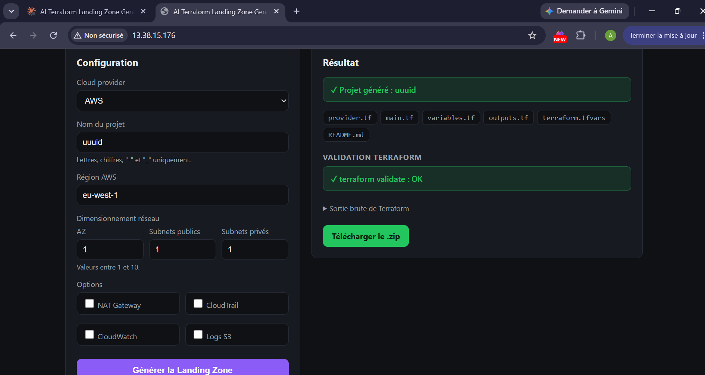
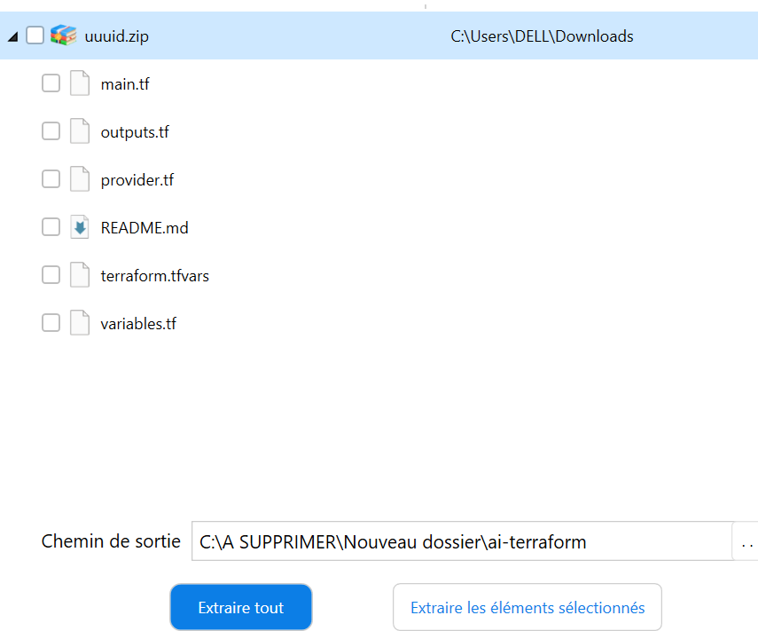
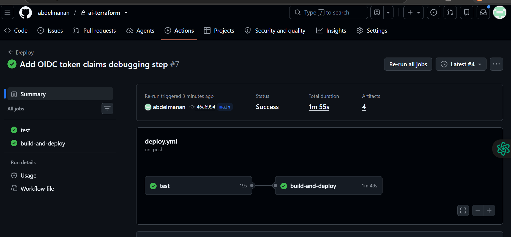
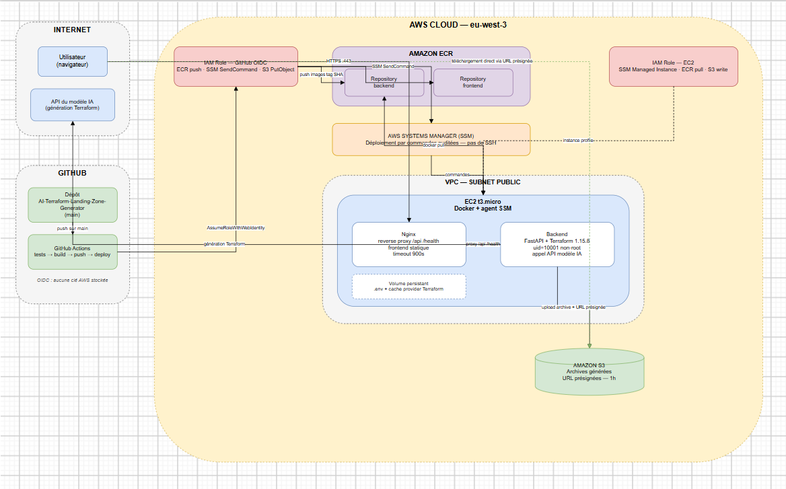
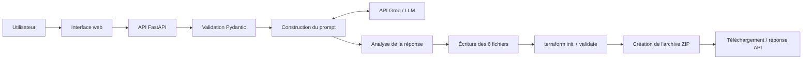

<div align="center">

# AI Terraform Landing Zone Generator

**Générez une base d’infrastructure AWS avec l’IA, puis vérifiez sa configuration avec Terraform.**

[](https://www.python.org/)
[](https://fastapi.tiangolo.com/)
[](https://developer.hashicorp.com/terraform)
[](https://www.docker.com/)
[](https://github.com/features/actions)
[](https://aws.amazon.com/)

</div>

> **Statut : projet personnel fonctionnel.** Le flux de génération, la validation Terraform, les tests automatisés et le workflow de déploiement AWS ont été réalisés selon les éléments du projet. Le déploiement décrit repose sur une seule instance et utilise HTTP : il ne doit pas être considéré comme prêt pour la production.

[English version](README.md)

## Sommaire

- [Présentation](#présentation)
- [Démonstration](#démonstration)
- [Fonctionnalités](#fonctionnalités)
- [Architecture](#architecture)
- [Technologies](#technologies)
- [Installation locale](#installation-locale)
- [Utilisation](#utilisation)
- [Tests et CI/CD](#tests-et-cicd)
- [Déploiement AWS](#déploiement-aws)
- [Sécurité et limites](#sécurité-et-limites)
- [Améliorations possibles](#améliorations-possibles)
- [Auteur](#auteur)

## Présentation

Créer manuellement une base réseau AWS demande du temps et une bonne connaissance de Terraform. Un modèle d’IA peut accélérer la rédaction du code, mais sa sortie peut être incomplète ou invalide.

**AI Terraform Landing Zone Generator** automatise une partie de ce travail : l’utilisateur renseigne quelques paramètres, l’application demande à un modèle de langage de générer un projet Terraform, puis vérifie le résultat avec la CLI Terraform avant de préparer une archive ZIP.

Le principe d’ingénierie est simple : **l’IA propose le code, des contrôles déterministes le vérifient.**

Le projet vise notamment les étudiants et les profils Cloud/DevOps qui souhaitent comprendre et expérimenter un flux de génération d’infrastructure.

## Démonstration


### Interface de génération




### Fichiers Terraform générés




### Pipeline GitHub Actions




### Architecture de déploiement AWS




## Fonctionnalités

### Fonctionnalités vérifiées dans le code examiné

- API FastAPI avec l’endpoint `POST /api/generate`.
- Validation des paramètres de requête avec Pydantic.
- Génération via une API compatible OpenAI, configurée pour utiliser Groq et le modèle `openai/gpt-oss-120b`.
- Analyse de la réponse du modèle et vérification de la présence des six fichiers attendus.
- Écriture des fichiers dans un répertoire de projet isolé.
- Exécution de `terraform init` puis `terraform validate`.
- Création d’une archive ZIP sans le dossier `.terraform/` ni `.terraform.lock.hcl`.
- Route de santé `GET /health` et gestion structurée des erreurs.

### Fonctionnalités annoncées, à confirmer dans la version actuelle

Les éléments suivants sont décrits dans le projet, mais n’ont pas tous pu être revérifiés dans le code examiné. Vérifiez-les avant de les présenter comme des fonctionnalités garanties :

- Interface web statique en français.
- Conteneurs Docker pour le frontend et le backend.
- Stockage des archives dans S3 avec liens présignés.
- Workflow GitHub Actions qui construit et publie les images dans ECR puis déploie via AWS Systems Manager.
- Déploiement AWS sur EC2.

### Ce que l’application ne fait pas

- Elle n’exécute pas `terraform plan` ni `terraform apply`.
- Elle ne déploie pas l’infrastructure générée.
- Elle ne garantit ni la sécurité, ni le coût, ni le bon fonctionnement réel du code généré.
- Elle prend en charge AWS et un seul template : `landing-zone`.
- Elle dépend d’un service LLM externe et ne dispose pas de mode hors ligne.

## Architecture

### Flux de génération



### Étapes principales

1. L’API valide la configuration reçue.
2. Le service construit un prompt et appelle le modèle de langage.
3. Le parseur extrait les fichiers Terraform et vérifie leur présence.
4. Les fichiers sont écrits dans le répertoire du projet.
5. Terraform exécute `init` puis `validate`.
6. Le projet est empaqueté en ZIP et le résultat de validation est renvoyé.

**À retenir :** une réponse HTTP 200 ne signifie pas nécessairement que Terraform a validé le projet. Consultez le champ `validation.valid` et les diagnostics associés.

## Technologies

| Technologie | Utilisation |
|---|---|
| Python 3.12 | Backend |
| FastAPI et Uvicorn | API HTTP |
| Pydantic | Validation des entrées |
| API Groq via SDK compatible OpenAI | Génération de code |
| Terraform CLI | Initialisation et validation du projet généré |
| pytest | Tests automatisés |
| Docker et nginx | Conteneurisation et service web, selon la configuration du projet |
| GitHub Actions | Pipeline CI/CD |
| AWS EC2, ECR, S3, SSM et IAM | Ressources du déploiement décrit |

## Installation locale

### Prérequis

- Git
- Python 3.12 recommandé
- Terraform CLI disponible dans le `PATH`
- Une clé API Groq pour effectuer une génération réelle
- Docker, uniquement si vous souhaitez utiliser les conteneurs

### 1. Cloner le dépôt

Remplacez l’URL par celle de votre dépôt GitHub :

```bash
git clone https://github.com/<votre-utilisateur>/AI-Terraform-Landing-Zone-Generator.git
cd AI-Terraform-Landing-Zone-Generator
```

### 2. Créer un environnement virtuel

**Linux / macOS**

```bash
python3 -m venv .venv
source .venv/bin/activate
pip install -r requirements.txt
```

**Windows PowerShell**

```powershell
python -m venv .venv
.\.venv\Scripts\Activate.ps1
pip install -r requirements.txt
```

### 3. Configurer les variables d’environnement

Créez un fichier `.env` à la racine du dépôt :

```dotenv
GROQ_API_KEY=votre_cle_api
CORS_ORIGINS=http://localhost:5173,http://localhost:3000
```

Ne partagez jamais votre clé API et ne la commitez pas dans Git.

### 4. Démarrer l’API

Depuis la racine du dépôt :

```bash
uvicorn backend.app:app --reload --port 8000
```

Vérifiez le service :

```bash
curl http://localhost:8000/health
```

La réponse attendue est :

```json
{"status":"healthy"}
```

Documentation interactive : [http://localhost:8000/docs](http://localhost:8000/docs)

### 5. Démarrer le frontend (si applicable)

Si le frontend statique est présent et appelle correctement l’API depuis cette origine :

```bash
python -m http.server 5173 --directory frontend
```

Puis ouvrez [http://localhost:5173](http://localhost:5173).

> Selon la configuration du frontend et du proxy, un simple serveur statique peut ne pas suffire pour les appels API. Si nécessaire, utilisez la configuration Docker/nginx du dépôt après l’avoir vérifiée.

## Utilisation

L’endpoint principal est `POST /api/generate`.

Exemple de requête :

```bash
curl -X POST http://localhost:8000/api/generate \
  -H "Content-Type: application/json" \
  -d '{
    "cloud": "aws",
    "project_name": "demo-landing-zone",
    "region": "eu-west-1",
    "template": "landing-zone",
    "availability_zones": 2,
    "public_subnets": 2,
    "private_subnets": 2,
    "enable_nat_gateway": true,
    "enable_cloudtrail": false,
    "enable_cloudwatch": false,
    "enable_s3_logs": false
  }'
```

Le projet généré contient les six fichiers suivants :

```text
demo-landing-zone/
├── provider.tf
├── main.tf
├── variables.tf
├── outputs.tf
├── terraform.tfvars
└── README.md
```

La réponse de l’API inclut notamment les fichiers générés et l’état de validation Terraform. Si la validation échoue, examinez les diagnostics avant de réessayer ou de corriger le code.

### Avant tout déploiement de l’infrastructure générée

Après avoir extrait l’archive, relisez les fichiers et vérifiez le plan avant toute création de ressources :

```bash
terraform fmt -check
terraform init
terraform validate
terraform plan
```

N’exécutez `terraform apply` qu’après avoir vérifié le plan, les permissions et les coûts potentiels. Certaines ressources AWS, notamment une NAT Gateway, peuvent entraîner des frais.

## Tests et CI/CD

Lancer les tests depuis la racine du dépôt :

```bash
python -m pytest -q
```

Les tests examinés couvrent notamment la validation des entrées, le parseur, la gestion des erreurs, l’écriture des fichiers, la validation Terraform simulée et la création de l’archive.

Ajoutez ici une capture réelle du résultat des tests :


Le workflow `.github/workflows/deploy.yml` est associé au pipeline `Deploy`. Le flux de déploiement décrit comprend les tests, la construction des images, leur publication dans ECR, une commande SSM et une vérification de santé. **Vérifiez le workflow et une exécution réussie avant d’affirmer que chaque étape est opérationnelle dans la version publiée.**

## Déploiement AWS

Le déploiement décrit s’appuie sur les composants suivants :

- **EC2** : exécution de l’application conteneurisée.
- **ECR** : stockage des images Docker.
- **S3** : stockage des archives générées, si cette option est configurée.
- **Systems Manager (SSM)** : canal d’administration et de déploiement.
- **IAM et OIDC** : autorisation du workflow GitHub Actions à accéder aux ressources AWS.
- **Groq API** : génération du code Terraform.

Le déploiement décrit utilise une seule instance EC2 et expose l’application en HTTP sur le port 80. L’infrastructure AWS du projet a été créée manuellement, et non entièrement décrite en Terraform.

Pour vérifier l’état de santé de l’application déployée :

```bash
curl http://<hote-de-l-instance>/health
```

Remplacez le placeholder par l’hôte approprié dans votre environnement privé. Évitez de publier une adresse IP publique si elle n’est pas nécessaire.

## Sécurité et limites

Des contrôles sont présents dans le code examiné, notamment la validation des entrées, le contrôle des chemins de fichiers, des délais d’exécution pour Terraform et une configuration CORS explicite.

Le projet présente néanmoins plusieurs limites importantes :

- **HTTP uniquement** sur le déploiement décrit : configurez HTTPS avant tout usage réel, particulièrement si une authentification transite par l’application.
- **Une seule instance EC2** : pas de haute disponibilité ni d’autoscaling démontré.
- **Pas d’application automatique du Terraform** : le code doit être relu et son plan examiné.
- **Sécurité du code généré non garantie** : `terraform validate` contrôle la configuration, pas l’ensemble des risques de sécurité ou de coûts.
- **Dépendance à un LLM externe** : disponibilité et quotas du fournisseur peuvent interrompre la génération.
- **Infrastructure AWS créée manuellement** : le déploiement n’est pas entièrement reproductible à partir d’un dépôt IaC.
- **Pas d’audit de sécurité ni de test d’intrusion réalisé** selon la documentation disponible.

Ne publiez jamais de clés API, secrets GitHub, identifiants de compte AWS, ARN sensibles ou journaux contenant des jetons.

## Améliorations possibles

- Ajouter HTTPS, un nom de domaine et une adresse IP stable.
- Décrire l’infrastructure de déploiement elle-même en Terraform.
- Ajouter une analyse statique de sécurité et une estimation des coûts.
- Tester `terraform plan` dans un compte AWS isolé.
- Étendre les templates et envisager d’autres fournisseurs cloud.
- Ajouter de la supervision et des alertes.

Ces éléments sont des pistes d’évolution, pas des fonctionnalités annoncées comme déjà livrées.

## Auteur

Projet personnel d’ingénierie réalisé dans le cadre d’un projet de fin d’année à l’ENSA d’Oujda, filière Management et Gouvernance des Systèmes d’Information, pendant un stage à distance chez Technologica (Oujda), selon les informations fournies dans la documentation du projet.

- GitHub : https://github.com/abdelmanan
- LinkedIn : www.linkedin.com/in/abdelmanane-mahamat-6483b4224
