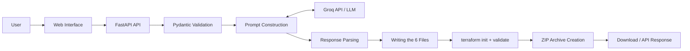

 <div align="center">

# AI Terraform Landing Zone Generator

**Generate an AWS infrastructure foundation with AI, then validate its configuration with Terraform.**

[](https://www.python.org/)
[](https://fastapi.tiangolo.com/)
[](https://developer.hashicorp.com/terraform)
[](https://www.docker.com/)
[](https://github.com/features/actions)
[](https://aws.amazon.com/)

</div>

> **Status: functional personal project.** The generation workflow, Terraform validation, automated tests, and AWS deployment workflow have been implemented according to the project documentation. The described deployment relies on a single instance and uses HTTP: it should not be considered production-ready.

[English version](README.md)

## Table of Contents

- [Overview](#présentation)
- [Demo](#démonstration)
- [Features](#fonctionnalités)
- [Architecture](#architecture)
- [Technologies](#technologies)
- [Local Installation](#installation-locale)
- [Usage](#utilisation)
- [Tests and CI/CD](#tests-et-cicd)
- [AWS Deployment](#déploiement-aws)
- [Security and Limitations](#sécurité-et-limites)
- [Possible Improvements](#améliorations-possibles)
- [Author](#auteur)

## Overview

Manually creating an AWS network foundation takes time and requires a good understanding of Terraform. An AI model can speed up code generation, but its output may be incomplete or invalid.

**AI Terraform Landing Zone Generator** automates part of this process: the user provides a few parameters, the application asks a language model to generate a Terraform project, then validates the result using the Terraform CLI before preparing a ZIP archive.

The engineering principle is simple: **AI proposes the code; deterministic checks validate it.**

The project is primarily intended for students and Cloud/DevOps professionals who want to understand and experiment with an infrastructure generation workflow.

## Demo

### Generation Interface


### Generated Terraform Files


### GitHub Actions Pipeline


### AWS Deployment Architecture


## Features

### Features verified in the reviewed code

- FastAPI API with the `POST /api/generate` endpoint.
- Request parameter validation using Pydantic.
- Generation through an OpenAI-compatible API, configured to use Groq and the `openai/gpt-oss-120b` model.
- Analysis of the model response and verification that the six expected files are present.
- Writing files to an isolated project directory.
- Execution of `terraform init` followed by `terraform validate`.
- Creation of a ZIP archive without the `.terraform/` directory or `.terraform.lock.hcl`.
- Health check route `GET /health` and structured error handling.

### Announced features to be confirmed in the current version

The following items are described in the project, but not all of them could be reverified in the reviewed code. Check them before presenting them as guaranteed features:

- Static web interface in French.
- Docker containers for the frontend and backend.
- Storage of archives in S3 with presigned links.
- GitHub Actions workflow that builds and publishes images to ECR, then deploys through AWS Systems Manager.
- AWS deployment on EC2.

### What the application does not do

- It does not execute `terraform plan` or `terraform apply`.
- It does not deploy the generated infrastructure.
- It does not guarantee the security, cost efficiency, or actual operational correctness of the generated code.
- It supports AWS and a single template: `landing-zone`.
- It depends on an external LLM service and does not provide an offline mode.

## Architecture

### Generation Workflow



### Main Steps

1. The API validates the received configuration.
2. The service builds a prompt and calls the language model.
3. The parser extracts the Terraform files and verifies that they are present.
4. The files are written to the project directory.
5. Terraform executes `init` followed by `validate`.
6. The project is packaged into a ZIP archive, and the validation result is returned.

**Key takeaway:** an HTTP 200 response does not necessarily mean that Terraform has validated the project. Check the `validation.valid` field and the associated diagnostics.

## Technologies

| Technology | Purpose |
|---|---|
| Python 3.12 | Backend |
| FastAPI and Uvicorn | HTTP API |
| Pydantic | Input validation |
| Groq API via an OpenAI-compatible SDK | Code generation |
| Terraform CLI | Initialization and validation of the generated project |
| pytest | Automated tests |
| Docker and nginx | Containerization and web serving, depending on the project configuration |
| GitHub Actions | CI/CD pipeline |
| AWS EC2, ECR, S3, SSM, and IAM | Resources used in the described deployment |

## Local Installation

### Prerequisites

- Git
- Python 3.12 recommended
- Terraform CLI available in the `PATH`
- A Groq API key to perform an actual generation
- Docker, only if you want to use the containers

### 1. Clone the Repository

Replace the URL with that of your GitHub repository:

```bash
git clone https://github.com/abdelmanan/ai-terraform
cd ai-terraform
```

### 2. Create a Virtual Environment

**Linux / macOS**

```bash
python3 -m venv .venv
source .venv/bin/activate
pip install -r requirements.txt
```

**Windows PowerShell**

```powershell
python -m venv .venv
.\.venv\Scripts\Activate.ps1
pip install -r requirements.txt
```

### 3. Configure Environment Variables

Create a `.env` file at the root of the repository:

```dotenv
GROQ_API_KEY=your_api_key
CORS_ORIGINS=http://localhost:5173,http://localhost:3000
```

### 4. Start the API

From the root of the repository:

```bash
uvicorn backend.app:app --reload --port 8000
```

Check the service:

```bash
curl http://localhost:8000/health
```

The expected response is:

```json
{"status":"healthy"}
```

Interactive documentation: [http://localhost:8000/docs](http://localhost:8000/docs)

### 5. Start the Frontend (if applicable)

If the static frontend is present and correctly calls the API from this origin:

```bash
python -m http.server 5173 --directory frontend
```

Then open [http://localhost:5173](http://localhost:5173).

> Depending on the frontend and proxy configuration, a simple static server may not be sufficient for API calls. If necessary, use the repository's Docker/nginx configuration after verifying it.

## Usage

The main endpoint is `POST /api/generate`.

Example request:

```bash
curl -X POST http://localhost:8000/api/generate \
  -H "Content-Type: application/json" \
  -d '{
    "cloud": "aws",
    "project_name": "demo-landing-zone",
    "region": "eu-west-1",
    "template": "landing-zone",
    "availability_zones": 2,
    "public_subnets": 2,
    "private_subnets": 2,
    "enable_nat_gateway": true,
    "enable_cloudtrail": false,
    "enable_cloudwatch": false,
    "enable_s3_logs": false
  }'
```

The generated project contains the following six files:

```text
demo-landing-zone/
├── provider.tf
├── main.tf
├── variables.tf
├── outputs.tf
├── terraform.tfvars
└── README.md
```

The API response includes, among other things, the generated files and the Terraform validation status. If validation fails, review the diagnostics before retrying or fixing the code.

### Before Deploying the Generated Infrastructure

After extracting the archive, review the files and check the plan before creating any resources:

```bash
terraform fmt -check
terraform init
terraform validate
terraform plan
```

Only run `terraform apply` after reviewing the plan, permissions, and potential costs. Some AWS resources, particularly a NAT Gateway, may incur charges.

## Tests and CI/CD

Run the tests from the root of the repository:

```bash
python -m pytest -q
```

The reviewed tests cover, among other things, input validation, the parser, error handling, file writing, simulated Terraform validation, and archive creation.

The `.github/workflows/deploy.yml` workflow is associated with the `Deploy` pipeline. The described deployment workflow includes tests, image building, publishing to ECR, an SSM command, and a health check. **Verify the workflow and a successful execution before claiming that every step is operational in the published version.**

## AWS Deployment

The described deployment relies on the following components:

- **EC2**: runs the containerized application.
- **ECR**: stores Docker images.
- **S3**: stores generated archives, if this option is configured.
- **Systems Manager (SSM)**: administration and deployment channel.
- **IAM and OIDC**: authorize the GitHub Actions workflow to access AWS resources.
- **Groq API**: generates Terraform code.

The described deployment uses a single EC2 instance and exposes the application over HTTP on port 80. The project's AWS infrastructure was created manually rather than being fully described in Terraform.

To check the health of the deployed application:

```bash
curl http://<instance-host>/health
```

Replace the placeholder with the appropriate host in your private environment. Avoid publishing a public IP address if it is not necessary.

## Security and Limitations

The reviewed code includes several controls, including input validation, file path checks, execution timeouts for Terraform, and explicit CORS configuration.

However, the project has several important limitations:

- **HTTP only** in the described deployment: configure HTTPS before any real-world use, particularly if authentication is transmitted through the application.
- **A single EC2 instance**: no demonstrated high availability or autoscaling.
- **No automatic Terraform application**: the code must be reviewed and its plan examined.
- **Generated code security is not guaranteed**: `terraform validate` checks the configuration, not all security risks or potential costs.
- **Dependency on an external LLM**: provider availability and quotas may interrupt generation.
- **AWS infrastructure created manually**: the deployment is not fully reproducible from an IaC repository.
- **No security audit or penetration test performed**, according to the available documentation.

Never publish API keys, GitHub secrets, AWS account credentials, sensitive ARNs, or logs containing tokens.

## Possible Improvements

- Add HTTPS, a domain name, and a stable IP address.
- Describe the deployment infrastructure itself using Terraform.
- Add static security analysis and cost estimation.
- Test `terraform plan` in an isolated AWS account.
- Expand the templates and consider other cloud providers.
- Add monitoring and alerts.

These are potential improvements, not features claimed to have already been delivered.

## Author

Personal engineering project completed as part of a final-year project at ENSA Oujda, in the Information Systems Management and Governance program, during a remote internship at Technologica (Oujda), according to the information provided in the project documentation.

- GitHub: https://github.com/abdelmanan
- LinkedIn: www.linkedin.com/in/abdelmanane-mahamat-6483b4224
